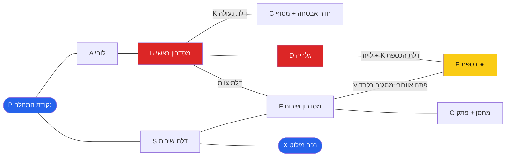
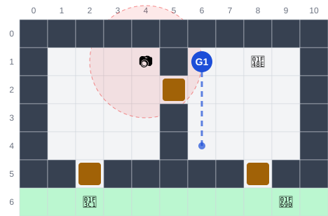
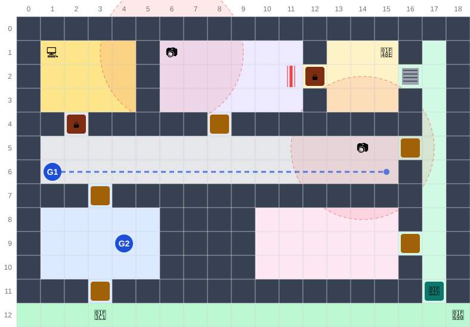
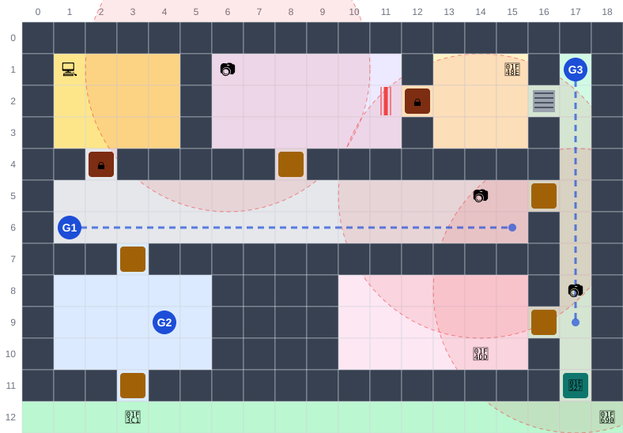
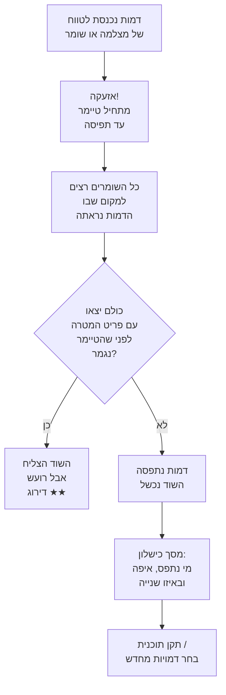
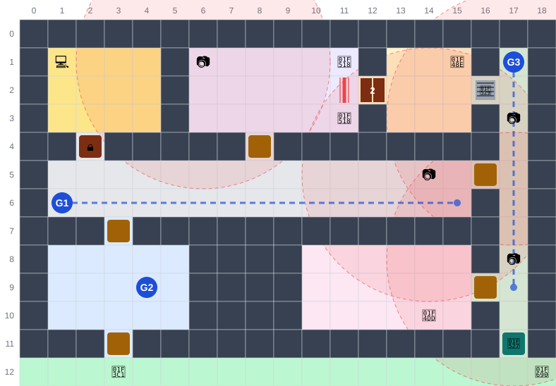

# תכנון רמות – השוד המושלם | PERFECT HEIST

**חברי הצוות:** אביתר אהרון, כפיר נזרי

---

## מבנה הרמות

במשחק יש **רמת מדריך** ו**שלוש רמות קושי**. רמת הקושי קובעת את **החוקים**, את **כוח האבטחה** ואת **משכי הפעולות** בזמן ההרצה. היא לא קובעת את המפה: בכל רמת קושי אפשר לשחק בכל אחד משלבי המשחק (חנות התכשיטים, המוזיאון והבנק). כדי להראות בדיוק איך נראית כל רמה, המסמך משתמש ב[מפת דוגמה](#מפת-הדוגמה) אחת, ובכל רמה מוסבר מה משתנה בה.

> **בכל הרמות, זמן התכנון ובחירת הדמויות תמיד ללא הגבלה.** מה שמשתנה בין הרמות הוא רק מה שקורה **אחרי** הלחיצה על "הפעל": משך הפעולות, משך היכולות, הזמן עד שהשומרים תופסים, וחלון הזמן להשלמת השוד.

| | מדריך | קלה | בינונית | קשה |
|---|---|---|---|---|
| **מהות** | לימוד המשחק | המשחק הרגיל | יותר אבטחה, צוות גדול יותר | בינונית + חלון זמן קצר ומכשולים מורכבים |
| **דמויות בצוות** | 2, קבועות מראש | 2 (שלישית אופציונלית בשלבים מתקדמים) | **לפחות 3** | **4** |
| **אפשר להיפסל?** | לא | כן | כן | כן |
| **אזעקה עד תפיסה** | אין תפיסה | 15 שניות | 8 שניות | 5 שניות |
| **מצלמות** | מצלמה אחת | רדיוס 3 משבצות | יותר מצלמות, רדיוס 4.5 | עוד מצלמות, רדיוס 4.5 |
| **חלון זמן להרצה** | ללא | ללא | ללא | **כן** (במפת הדוגמה: 55 שניות) |
| **קודי כספות** | אין | אין | קוד מפוצל לשני רמזים | חידה: חובה או קיצור דרך |
| **מכשולים מיוחדים** | – | לייזר, דלתות נעולות | כמו בקלה | + דלת כפולה, פתח אוורור עם סורג |

**איך לומדים חוקים חדשים:** המדריך מלמד רק את חוקי הבסיס. החוקים של הבינונית והקשה מוצגים בכרטיס המשימה בכניסה הראשונה לרמה, ובהודעה קצרה ליד כל מכשול חדש בפעם הראשונה שהוא מופיע במפה.

### ההתאמה לסקר השוק

| ממצא מסקר השוק | ההחלטה בתכנון |
|---|---|
| קהל עיקרי: זוגות וחברים (16–35) שמשחקים יחד, קז׳ואליים עד mid-core | המדריך מלמד כבר מההתחלה לתכנן כל דמות בנפרד ולתאם ביניהן דרך ציר הזמן המשותף. ברמה הבינונית והקשה יש 3–4 דמויות, כך שבמצב זוגי **לכל שחקן יש תפקיד משמעותי** ולא רק דמות אחת |
| מוטיבציה מרכזית: "בלי לחץ זמן" | התכנון ללא הגבלה בכל הרמות. גם ברמה הקשה, חלון הזמן חל רק על ההרצה וידוע מראש |
| מוטיבציה: "ניסוי וטעייה" | במדריך אי אפשר להיפסל: ההילה מובילה לתוכנית הנכונה, כך שהשחקן לומד את הכלים בלי לחץ. בשאר הרמות, אחרי כישלון התוכנית נשמרת ואפשר לתקן אותה |
| קהל משני: שחקני תכנון מגיל 12 | הרמה הקלה משתמשת רק בחוקי הבסיס. החידות שמורות לרמה הקשה |
| מוטיבציה: "סיפוק מביצוע" | ברמה הקשה התזמון צריך להיות מדויק לשנייה (דלת כפולה, חלון זמן), כך שתוכנית שעובדת מרגישה כמו "שוד מושלם" |

### מוסכמות

- **קואורדינטות:** כל משבצת היא יחידה אחת ב־Unity. ‏(0,0) היא הפינה השמאלית העליונה, ו־y גדל כלפי מטה.
- **מהירות הליכה:** 2 משבצות בשנייה לכל הדמויות. המתגנב הולך באותה מהירות, אבל בשקט.
- **שומר:** רואה 3 משבצות לפני כיוון ההליכה, בזווית של 90°. מסלול הסיור קבוע וחוזר על עצמו בכל ניסיון.
- **מצלמה:** רואה בעיגול סביבה ברדיוס שנקבע לפי רמת הקושי. היא לא רואה דרך קירות.
- **האקר:** משבית מצלמה מרחוק, מכל מקום במפה, ולכן הוא יכול להישאר בחוץ לאורך כל השוד.
- **אזעקה:** כשמצלמה או שומר רואים דמות, נדלקת אזעקה. כל השומרים רצים (פי 1.5 מהליכה) אל המקום שבו הדמות נראתה, ומתחיל טיימר "עד תפיסה". אם הטיימר נגמר בזמן שדמות עדיין בתוך הבניין, **הדמות נתפסת והשוד נכשל**. אם כל הדמויות יצאו עם פריט המטרה לפני כן, השוד מצליח, אבל מקבל דירוג נמוך ("שוד רועש").
- **דירוג:** ★★★ בלי אזעקה, ★★ עם אזעקה, ★ אם השוד הצליח רק אחרי יותר מ־5 ניסיונות.

### משכי פעולות לפי רמה

כל הערכים בשניות של זמן ההרצה.

| פעולה | קלה | בינונית | קשה |
|---|---|---|---|
| פתיחת דלת נעולה: פורץ / אחרים | 3 / 8 | 4 / 10 | 5 / 12 |
| פתיחת כספת: פורץ / אחרים | 4 / 10 | 6 / 14 | 8 / 18 |
| הקלדת קוד בכספת | 2 | 2 | 2 |
| האקר: השבתת מצלמה (משך ההשפעה) | 8 | 6 | 5 |
| מתחזה: הסחת דעת של שומר (משך ההשפעה) | 6 | 5 | 4 |
| טכנאי: השבתת לייזר (משך ההשפעה) | 8 | 6 | 5 |
| טכנאי: פתיחת דלת שירות או סורג | 2 | 2 | 3 |
| מסוף אבטחה: השבתת לייזר בידי כל דמות (3 שניות הפעלה) | 8 | 6 | 5 |

לכל יכולת פעילה (השבתת מצלמה, הסחת דעת, השבתת לייזר) יש **2 שימושים בכל ניסיון**, כמו במסמך הרכיבים הרשמיים.

---

## מפת הדוגמה

המפה הזו משמשת להמחשה של שלוש רמות הקושי. זה בניין עם כספת בפינה הצפונית־מזרחית, ושתי דרכים להגיע אליה:
- **הדרך הראשית:** דרך הלובי, המסדרון והגלריה.
- **הדרך האחורית:** דרך דלת השירות, מסדרון השירות ופתח האוורור.

### החדרים

| חדר | תפקיד | הערות |
|---|---|---|
| **A לובי** | אזור אורחים | שומר קבוע (G2) מסתכל על דלת הכניסה. המתחזה עובר בו בלי להתגלות |
| **B מסדרון ראשי** | מעבר מרכזי | שומר מסייר (G1). מצלמה (CAM1) בצד המזרחי, ליד דלת הצוות |
| **C חדר אבטחה** | מסוף שמשבית את הלייזר | דלת נעולה. בבינונית: חצי מקוד הכספת מופיע על המסך |
| **D גלריה** | הדרך הראשית לכספת | מצלמה (CAM2) בפינה המערבית. בקשה: ציורים עם מספרים לחידה |
| **E כספת** | פריט המטרה ($) | דלת נעולה מצד הגלריה, ופתח אוורור מצד מסדרון השירות |
| **F מסדרון שירות** | דרך חלופית | נכנסים מדלת השירות. מהבינונית: שומר (G3) ומצלמה (CAM3) |
| **G מחסן** | רמז | פתק עם חלק מקוד הכספת (בבינונית) או ההוראות לחידה (בקשה) |
| **X רכב מילוט** | נקודת החילוץ | מחוץ לדלת השירות. כל הדמויות צריכות להגיע אליו |

### מקרא למפות

המספרים בשולי כל מפה הם הקואורדינטות: x למעלה, y בצד.

| סימן | משמעות | סימן | משמעות |
|---|---|---|---|
| ריבוע אפור כהה | קיר | ירוק בהיר | שטח פתוח בחוץ |
| צבע רקע | החדר: כחול = לובי A, אפור = מסדרון B, צהוב = חדר אבטחה C, סגול = גלריה D, כתום בהיר = כספת E, ירוק = מסדרון שירות F, ורוד = מחסן G | ריבוע חום | דלת פתוחה |
| 🔒 | דלת נעולה | 🔧 | דלת שירות (טכנאי, או פורץ שפותח מנעול) |
| ריבוע עם פסים | פתח אוורור (מתגנב בלבד) | קו אדום | מחסום לייזר |
| 📷 + עיגול אדום מקווקו | מצלמה וטווח הראייה שלה | G1 / G2 / G3 | שומרים (מיקום התחלתי) |
| קו כחול מקווקו | מסלול הסיור של השומר | 💎 | כספת עם פריט המטרה |
| 💻 | מסוף אבטחה | 📝 | פתק רמז |
| 🏁 / 🚐 | נקודת התחלה / רכב מילוט | דלת חומה עם "2" | דלת כפולה (קשה) |
| 🔘 | לוח פתיחה של הדלת הכפולה (קשה) | 🔩 | סורג על פתח האוורור (קשה) |

---

## רמה 0 – מדריך: "השוד הראשון"

**מטרה:** ללמד את כל שלבי המשחק, מבחירת צוות ועד הרצה, בלי אפשרות להיפסל. זה המשחקון מהמטלה הראשונה: מפת הדרכה קטנה עם פריט מטרה, מסלול של שומר אחד ונקודת יציאה.

### המפה

| אובייקט | מיקום | התנהגות |
|---|---|---|
| חדר הכניסה | x1–4, y1–4 | נכנסים מהדלת (2,5) |
| מצלמה | (4,1) | רדיוס 2. מכסה את הדלת (5,2) לחדר המטרה |
| שומר G1 | (6,1) | מסייר בין (6,1) ל־(6,4) וחזרה. סיבוב מלא כל 8 שניות |
| פריט המטרה | (8,1) | יהלום על כן תצוגה |
| יציאה | הדלת (8,5) אל X ב־(9,6) | כל הדמויות צריכות להגיע ל־X |

### שלבי המדריך

הצוות במדריך הוא **האקר ומתגנב**, כמו בדוגמה שבמסמך הרכיבים הרשמיים. שאר הדמויות מוצגות כצלליות נעולות. כל שלב נפתח רק אחרי שהקודם הושלם. בכל שלב מסומן בהילה הדבר היחיד שאפשר ללחוץ עליו, עם בועת הסבר קצרה. לחיצה מחוץ להילה לא עושה כלום.

| # | ההודעה לשחקן | מה השחקן עושה | מה לומדים |
|---|---|---|---|
| 1 | "לכל שוד צריך צוות, ולכל דמות יש יכולת מיוחדת. בשוד הזה צריך 2 דמויות" | במסך בחירת הצוות לוחץ על ההאקר, קורא את היכולות שלו ולוחץ "Add to crew". אחר כך עושה אותו דבר עם המתגנב, ולוחץ "Start planning" | בחירת צוות ויכולות הדמויות |
| 2 | "זו מפת השוד: היהלום, רכב המילוט, השומר עם מסלול הסיור המקווקו, המצלמה עם טווח הראייה שלה, והצוות שלך" | עובר על האובייקטים המסומנים בהילה אחד אחרי השני | קריאת המפה והאיומים |
| 3 | "לחץ על ההאקר כדי לתכנן את הצעדים שלו" | פותח את חלון ציר הזמן של ההאקר, ורואה את ציר הזמן ואת כפתורי הפעולות שלו. "Camera off" מופיע רק להאקר | חלון ציר הזמן ויכולת ייחודית לדמות |
| 4 | "קודם ההאקר מחכה, ואז מכבה את המצלמה" | לוחץ 3 פעמים "Wait +1s" (בלוק המתנה של 3 שניות), ואז "Camera off" ולוחץ על המצלמה. בציר הזמן רואים שהמצלמה כבויה משנייה 3 למשך 8 שניות | פקודת המתנה, ויכולת מתוזמנת ומשך ההשפעה שלה |
| 5 | "עכשיו ההאקר בורח לרכב" | לוחץ "Walk" ואז על המשבצת ליד הרכב, ולוחץ "Done". התוכנית של ההאקר מוכנה | פקודת תנועה בלחיצה על המפה |
| 6 | "השומר הולך לכיוון הדלת. מחכים שיפנה את הגב" | בוחר את המתגנב ונותן לו: הליכה לחדר הראשון (3,3), המתנה של 6 שניות ("Wait +5s" ואז "Wait +1s"), הליכה דרך הדלת ל־(7,2), הליכה ליהלום ו־"Pick up", ובריחה בצד הימני (9,1) ← (9,4) עד הרכב. השורה של ההאקר מוצגת בציר הזמן כדי לתאם עם המצלמה הכבויה (שנייה 3 עד 11) | תיאום בין שתי דמויות, מסלולי סיור קבועים, איסוף פריט ותנאי ניצחון: כולם ברכב |
| 7 | "התוכנית מוכנה! לחץ RUN וצפה בה מתבצעת" | רואה על המפה את הקווים הצבעוניים של המסלולים, לוחץ RUN וצופה בהרצה. מי שמגיע לרכב נכנס אליו, והרכב נוסע עם היהלום | הרצה אוטומטית של התוכנית |

**אין פסילה במדריך:**
- בכל שלב אפשר ללחוץ רק בתוך ההילה, ולכן השחקן בונה תמיד את התוכנית הנכונה. אין דרך לטעות, וההרצה מסתיימת תמיד בהצלחה.
- כפתור RUN מוסתר עד שהתוכנית מוכנה, כך שאי אפשר להריץ תוכנית חלקית.
- אין חלון זמן ואין אזעקה. בסוף מגיעים למסך הניצחון, עם זמן ההרצה ומספר הניסיונות.
- את מנגנון הכישלון (חלון "Attempt failed" עם מי התגלה ובאיזו שנייה, וחזרה לתכנון עם התוכנית שמורה) השחקן יפגוש לראשונה ברמה הקלה.

**למה זה מתאים לרמת מדריך:** פעולה אחת חדשה בכל שלב, ושני חדרים בלבד. ההילה מובילה את השחקן צעד אחר צעד לתוכנית שמצליחה, כך שהשוד הראשון תמיד נגמר בהצלחה ובתחושת הישג. השחקן לומד כבר מההתחלה שלכל דמות יש תוכנית משלה, ושצריך לתאם את התזמון בין הדמויות. זה הלב של המשחק לפי סקר השוק.

---

## רמה 1 – קלה: המשחק הרגיל

**מטרה:** השוד כפי שתוכנן במסמך [הרכיבים הרשמיים](formal-elements.perfect-heist%20.md). שומרים ומצלמות יכולים לתפוס את השודדים, וכישלון מחזיר לתכנון.

### החוקים

| נושא | הערך |
|---|---|
| **צוות** | 2 דמויות שונות מתוך 5. בשלבים מתקדמים נפתחת אפשרות לדמות שלישית מסייעת, אבל היא לא חובה |
| **אבטחה** | שומרים עם מסלולים קבועים, ומצלמות ברדיוס 3 משבצות |
| **אזעקה** | 15 שניות מהאזעקה עד תפיסה. אפשר עוד לברוח אם כולם קרובים ליציאה |
| **חלון זמן** | אין |
| **כספות** | נפתחות בלי קוד. פורץ פותח אותן מהר יותר |
| **ניצחון** | פריט המטרה נאסף, וכל הדמויות הגיעו לרכב המילוט בלי שאחת מהן נתפסה |
| **אחרי כישלון** | "תקן תוכנית" (שומר את הפקודות) או "בחר דמויות מחדש" |

### מפת הדוגמה ברמה הקלה

| אבטחה | מיקום | התנהגות |
|---|---|---|
| G1 | מתחיל ב־(1,6) | הולך במסדרון B מ־x=1 ל־x=15 וחזרה. סיבוב מלא כל 15 שניות |
| G2 | (4,9) | עומד בלובי ומסתכל על דלת הכניסה (3,11). לא מגלה את המתחזה |
| CAM1 | (14,5) | רדיוס 3. מכסה את דלת הצוות (16,5) ואת הקצה המזרחי של המסדרון |
| CAM2 | (6,1) | רדיוס 3. מכסה את החלק המערבי של הגלריה |
| לייזר | (11,2) | דולק כל הזמן. מכובה על ידי טכנאי, או ממסוף האבטחה (1,1) |

### פתרון לדוגמה: מתגנב וטכנאי

```mermaid
gantt
    title פתרון לדוגמה ברמה הקלה (שניות מתחילת ההרצה)
    dateFormat X
    axisFormat %S
    section טכנאי
    הליכה לדלת השירות :t1, 0, 7
    פתיחת דלת השירות :t2, 7, 9
    הליכה לרכב המילוט :t3, 9, 10
    section מתגנב
    הליכה לדלת השירות :s1, 0, 7
    המתנה לדלת :s2, 7, 9
    הליכה במסדרון השירות לפתח האוורור :s3, 9, 14
    זחילה לכספת :s4, 14, 15
    פתיחת הכספת ואיסוף :s5, 15, 25
    חזרה דרך הפתח והמסדרון :s6, 25, 31
    הליכה לרכב המילוט :s7, 31, 32
```

ברמה הקלה אין אבטחה במסדרון השירות, ולכן הדרך האחורית בטוחה לגמרי. היא דורשת רק את שתי הדמויות הנכונות. צוות אחר, למשל **מתחזה ופורץ**, יכול להשתמש בדרך הראשית:
1. המתחזה מסיח את G2 בלובי כדי שהפורץ ייכנס.
2. הפורץ פותח את חדר האבטחה ומכבה את הלייזר מהמסוף.
3. בדרך החוצה, המתחזה מכבה את הלייזר שוב מהמסוף ומסיח את G2 פעם שנייה.

**למה זה מתאים לרמה קלה:** אלה בדיוק החוקים מהמדריך. יש יותר מדרך אחת לכספת, אז רוב צמדי הדמויות יכולים להצליח. גם אחרי אזעקה יש 15 שניות לברוח, כך שטעות אחת לא בהכרח מכשילה את השוד.

---

## רמה 2 – בינונית: יותר אבטחה, צוות גדול יותר

**מטרה:** אי אפשר להצליח עם שתי דמויות בלבד. יש יותר מצלמות, הן רואות רחוק יותר, ומרגע האזעקה יש הרבה פחות זמן עד שהשומרים תופסים מישהו.

**כרטיס המשימה:** "האבטחה תוגברה: יותר מצלמות ברדיוס גדול יותר. אם מישהו נכנס לטווח של מצלמה, נדלקת אזעקה, ויש לכם רק 8 שניות לצאת. תצטרכו צוות של לפחות 3."

### חוקים חדשים

1. **צוות של לפחות 3:** במסך הבחירה כפתור "המשך" נפתח רק אחרי שנבחרו 3 דמויות לפחות. אפשר לבחור גם 4. במצב זוגי, השחקנים מחליטים מי אחראי על כל דמות נוספת.
2. **יותר מצלמות, ברדיוס גדול יותר:** רדיוס 4.5 משבצות במקום 3, ובכל שלב נוספות 1–2 מצלמות במקומות שהיו בטוחים ברמה הקלה.
3. **אזעקה מהירה:** מהרגע שמצלמה או שומר רואים דמות, יש **8 שניות** עד תפיסה, במקום 15. בפועל, אחרי אזעקה כמעט אי אפשר לברוח.
4. **פעולות ארוכות יותר ויכולות קצרות יותר:** לפי טבלת משכי הפעולות. למשל, ההאקר משבית מצלמה ל־6 שניות במקום 8.
5. **קוד מפוצל:** הכספת דורשת קוד בן 4 ספרות, שמחולק לשני רמזים בשני חדרים שונים. את הרמזים רואים בזמן התכנון בלחיצה על האובייקט, ואת הקוד מכניסים לתוכנית כפקודת "הקלדת קוד". קוד שגוי מפעיל אזעקה מיד, וחלון הכישלון אומר במפורש שהקוד היה שגוי (ראו [קוד שגוי ומחיר לניחוש](#קוד-שגוי-ומחיר-לניחוש)).

### מפת הדוגמה ברמה הבינונית

השינויים מהרמה הקלה:
- **CAM3** חדשה ב־(17,8).
- **שומר G3** חדש, מתחיל ב־(17,1).
- CAM1 ו־CAM2 עוברות לרדיוס 4.5.
- רמזים לקוד הכספת במסוף (1,1) ובפתק (14,10).

| אבטחה | מה השתנה | ההשפעה |
|---|---|---|
| CAM1 | רדיוס 4.5 | מכסה את דלת הצוות ואת כל החצי המזרחי של המסדרון |
| CAM2 | רדיוס 4.5 | מכסה עכשיו גם את הכניסה לגלריה (8,4) |
| **CAM3** (חדשה) | (17,8), רדיוס 4.5 | מכסה את דלת השירות ואת מסדרון השירות מ־y=4 ומטה. פתח האוורור מחוץ לטווח |
| **G3** (חדש) | מתחיל ב־(17,1) | הולך במסדרון השירות מ־y=1 ל־y=9, נכנס למחסן ל־8 שניות וחוזר. סיבוב מלא כל 26 שניות |
| **קוד** | – | במסוף (1,1) מופיע "4 8 _ _", ובפתק (14,10) מופיע "_ _ 1 5". הקוד: 4815 |

### למה צריך 3 דמויות במפה הזו

בכל אחת משתי הדרכים לכספת יש **שלוש בעיות**, ולכל אחת צריך דמות:

| הדרך | בעיה 1 | בעיה 2 | בעיה 3 | צוות לדוגמה |
|---|---|---|---|---|
| **אחורית** | דלת השירות נעולה | CAM3 רואה את המסדרון, בכניסה וביציאה | רק מתגנב עובר בפתח האוורור | טכנאי + האקר (CAM3 פעמיים) + מתגנב. המתגנב מחכה בתוך הכספת עד ש־G3 נכנס למחסן |
| **ראשית** | G2 רואה מי שנכנס בדלת הלובי | CAM2 רואה את הכניסה לגלריה, בכניסה וביציאה | הלייזר ודלת הכספת הנעולה | מתחזה (G2 פעמיים) + האקר (CAM2 פעמיים) + טכנאי (לייזר פעמיים, ופותח את הדלת ואת הכספת בעצמו) |

- **הכלל "אין שלב שמחייב דמות מסוימת" נשמר:** לכל בעיה יש יותר מפתרון אחד. למשל, את דלת השירות אפשר לפתוח גם עם פורץ, ואת הלייזר אפשר לכבות גם במסוף.
- **דמות רביעית מקצרת את השוד:** פורץ בדרך הראשית פותח את דלת הכספת ואת הכספת בזמן קצר בהרבה מהטכנאי.

### תרשים: מה קורה כשנדלקת אזעקה

| רמה | זמן עד תפיסה |
|---|---|
| קלה | 15 שניות |
| בינונית | 8 שניות |
| קשה | 5 שניות |

**למה זה מתאים לרמה בינונית:** החוקים של הרמה הקלה נשארים. מה שמשתנה הוא שאין יותר "דרך בטוחה": כל דרך דורשת לטפל בשלוש בעיות, ולכן צריך לתאם שלושה צירי זמן. במצב זוגי זה אומר שאחד השחקנים מנהל שתי דמויות, ושני השחקנים צריכים לדבר ולתאם. זו בדיוק החוויה המשותפת שסקר השוק מצא שזוגות מחפשים.

---

## רמה 3 – קשה: חלון זמן ומכשולים מורכבים

**מטרה:** כל מה שיש בבינונית, ובנוסף **חלון זמן קצר להשלמת השוד** מרגע הלחיצה על "הפעל", ומכשולים שדורשים תיאום מדויק.

**כרטיס המשימה:** "יש לכם 55 שניות מרגע ההפעלה ועד שכל הצוות ברכב. הכספת מוגנת בדלת כפולה ובקוד מוצפן. תכננו בלי לחץ, אבל דעו שבזמן ההרצה כל שנייה חשובה. צוות: 4 דמויות."

### חוקים חדשים

1. **צוות של 4:** כל הדמויות שונות, מתוך 5. במצב זוגי כל שחקן אחראי לשתי דמויות.
2. **חלון זמן להרצה:** לכל שלב יש חלון זמן, שמוצג בכרטיס המשימה ומעל ציר הזמן בזמן התכנון. הספירה מתחילה רק בלחיצה על "הפעל". אם הזמן נגמר לפני שכל הדמויות ברכב המילוט, השוד נכשל. **זמן התכנון עדיין ללא הגבלה.**
3. **קו אדום בציר הזמן** מסמן את השנייה שבה נגמר החלון, כך שכבר בתכנון רואים אם התוכנית נכנסת בזמן.
4. **דלת כפולה:** נפתחת רק אם שני הלוחות שלה מופעלים **בהפרש של שנייה אחת לכל היותר**. צריך שתי דמויות, כל אחת ליד לוח אחר, עם פקודות מתוזמנות בדיוק לאותה שנייה. אחרי שנפתחה, היא נשארת פתוחה.
5. **קודים עם חידה:** הקוד לא כתוב במפה. במקום זה יש רמזים שצריך לפתור בזמן התכנון. יש שני סוגי חידות: **חידת חובה** ו**חידת קיצור דרך** (ראו [שני סוגי החידות](#שני-סוגי-החידות)).
6. **פתח האוורור חסום בסורג:** רק טכנאי פותח אותו (3 שניות).
7. **אזעקה מהירה מאוד:** 5 שניות מהאזעקה עד תפיסה. בפועל, כל גילוי מכשיל את השוד.

### מפת הדוגמה ברמה הקשה

השינויים מהרמה הבינונית:
- **דלת כפולה W** ב־(12,2) במקום דלת הכספת, עם **לוחות p** ב־(11,1) וב־(11,3).
- **סורג v** על פתח האוורור (16,2).
- **CAM4** חדשה ב־(17,3), רדיוס 4.5. יחד עם CAM3 היא מכסה את כל מסדרון השירות, כולל פתח האוורור.
- **G1 מהיר יותר:** סיבוב מלא כל 12 שניות במקום 15.
- **חלון זמן:** 55 שניות.

### החידה של הכספת

- **בגלריה תלויים 4 ציורים.** לוחצים עליהם בתכנון ורואים מספר על כל אחד: הציור **האדום** 7, **הכחול** 3, **הירוק** 9, **הצהוב** 1.
- **הפתק במחסן אומר:** "הקוד: מהצבע הקר ביותר אל החם ביותר".
- **הפתרון:** כחול (3), ירוק (9), צהוב (1), אדום (7). הקוד: **3917**.

*בשלבים אחרים ברמה הקשה יהיו חידות מסוגים שונים: סדר לפי שעון, חישוב פשוט מתוך מספרים בחדר, או שילוב של רמזים משני חדרים.*

### שני סוגי החידות

את החידה תמיד פותרים בזמן התכנון, ואת הקוד מכניסים לתוכנית כפקודת "הקלדת קוד" (2 שניות). אם הקוד נכון, מתגלה רק בזמן ההרצה. בכל שלב ברמה הקשה מופיע אחד משני הסוגים, וכרטיס המשימה אומר איזה מהם:

| | חידת חובה | חידת קיצור דרך |
|---|---|---|
| **בלי קוד** | אי אפשר לפתוח את הכספת | אפשר לפרוץ את המנעול האלקטרוני, אבל זה מוסיף **10 שניות** לפתיחת הכספת |
| **עם קוד נכון** | הכספת נפתחת (הקלדה ואז פתיחה, לפי טבלת משכי הפעולות) | הכספת נפתחת בלי 10 השניות הנוספות |
| **עם קוד שגוי** | אזעקה מיד | אזעקה מיד |
| **מה החידה בודקת** | שהשחקנים פתרו אותה. בלי פתרון אין שוד | בחירה: לפתור ולחסוך זמן, או לוותר ולתכנן סביב 10 שניות נוספות |

- **מפת הדוגמה ברמה הקשה משתמשת בחידת חובה.** בחלון של 55 שניות, גם בחידת קיצור דרך 10 שניות נוספות היו משאירות כמעט אפס מרווח.
- **חידות קיצור דרך** מתאימות לשלבים שבהם חלון הזמן רחב יותר. הן מתגמלות חשיבה, בלי שזוג שנתקע בחידה ייתקע בכל השלב, וזה חשוב לקהל המשני מגיל 12.

### קוד שגוי ומחיר לניחוש

- **חלון כישלון ברור:** כשקוד שגוי מפעיל אזעקה, חלון הכישלון אומר במפורש מה קרה, למשל: "הפורץ הקליד קוד שגוי בכספת בשנייה 17". כך השחקנים יודעים שהבעיה בחידה ולא בתזמון. החלון **לא מגלה את הקוד הנכון**. התוכנית נשמרת, ואפשר לתקן רק את הקוד.
- **מחיר לניחוש:** במפת הדוגמה יש 4 ציורים, כלומר רק 24 סדרים אפשריים, כך שאפשר לנסות לנחש. הדירוג מונע את זה: שוד שהצליח רק אחרי יותר מ־5 ניסיונות מקבל ★ אחד. ניחוש עדיין אפשרי למי שנתקע, אבל פתרון אמיתי שווה יותר כוכבים.

### למה צריך 4 דמויות במפה הזו

| הדרך | המכשולים, ומי מטפל בהם |
|---|---|
| **ראשית** | **מתחזה:** מסיח את G2 בכניסה וביציאה. **האקר** (מבחוץ): משבית את CAM2 בכניסה וביציאה. **פורץ וטכנאי:** לוחצים יחד על שני הלוחות של הדלת הכפולה. **טכנאי:** משבית את הלייזר בכניסה וביציאה. **פורץ:** מקליד את הקוד ופותח את הכספת. את G1 במסדרון עוקפים בתזמון |
| **אחורית** | **טכנאי:** פותח את דלת השירות ואת הסורג. **האקר:** משבית את CAM3 ואת CAM4. **מתחזה:** מסיח את G3. **מתגנב:** עובר בפתח, מקליד את הקוד ופותח את הכספת (18 שניות, ולכן הדרך הזו כמעט לא נכנסת בחלון הזמן) |

### תרשים: הפתרון לדוגמה מול חלון הזמן

*סכמטי. הזמנים המדויקים ייקבעו בבדיקות ב־Unity.*

```mermaid
gantt
    title פתרון לדוגמה ברמה הקשה - חלון של 55 שניות
    dateFormat X
    axisFormat %S
    section מתחזה
    הליכה ללובי :i1, 0, 3
    הסחת G2 בכניסה :crit, i2, 3, 7
    המתנה בלובי כאורח :i3, 7, 33
    הסחת G2 ביציאה :crit, i4, 33, 37
    הליכה לרכב המילוט :i5, 37, 45
    section האקר
    המתנה בחוץ :h1, 0, 9
    השבתת CAM2 בכניסה :crit, h2, 9, 14
    המתנה בחוץ :h3, 14, 27
    השבתת CAM2 ביציאה :crit, h4, 27, 32
    הליכה לרכב המילוט :h5, 32, 40
    section טכנאי
    מעבר בלובי ובמסדרון :t1, 3, 10
    הליכה ללוח p התחתון :t2, 10, 13
    לחיצה על הלוח :crit, t3, 13, 14
    השבתת לייזר בכניסה :crit, t4, 14, 19
    המתנה ליד הלוח :t5, 19, 25
    השבתת לייזר ביציאה :crit, t6, 25, 30
    יציאה דרך הגלריה הלובי והחוץ :t7, 27, 45
    section פורץ
    מעבר בלובי ובמסדרון :b1, 3, 10
    הליכה ללוח p העליון :b2, 10, 13
    לחיצה על הלוח :crit, b3, 13, 14
    כניסה לכספת והקלדת קוד :b4, 14, 17
    פתיחת הכספת :b5, 17, 25
    יציאה דרך הגלריה הלובי והחוץ :b6, 25, 45
    section חלון הזמן
    סוף חלון הזמן :milestone, m1, 55, 55
```

**התיאום הקשה בתוכנית:**
- **הכניסה:** הפורץ והטכנאי עוברים בלובי בין שנייה 3 ל־7, בזמן ש־G2 מוסח, ועוברים במסדרון כש־G1 הולך בכיוון השני.
- **הדלת הכפולה:** שני הלוחות נלחצים בשנייה 13. הלייזר כבוי מיד אחר כך (14–19), והפורץ נכנס לכספת בתוך החלון הזה.
- **היציאה:** שלושה חלונות צריכים לחפוף, אחד אחרי השני:
  1. הלייזר כבוי שוב (25–30).
  2. CAM2 כבויה (27–32).
  3. G2 מוסח (33–37).
- **המרווח:** כל הצוות ברכב בשנייה 45. נשארות 10 שניות מרווח עד שחלון הזמן נגמר.

**למה זה מתאים לרמה קשה:** החוקים של הרמה הבינונית נשארים, ונוספים שלושה סוגי לחץ: **זמן** (חלון ההרצה), **סנכרון** (דלת כפולה) ו**חשיבה** (חידת הקוד). הלחץ נמצא רק בהרצה ולא בתכנון. השחקנים יכולים לשבת על התוכנית כמה זמן שהם רוצים, וזה תואם את המוטיבציה "בלי לחץ זמן" מסקר השוק. במצב זוגי כל שחקן מנהל שתי דמויות, והדלת הכפולה מחייבת אותם לתאם בדיוק שנייה מול שנייה.

---

## הערות לאיזון

- כל הערכים (משכי פעולות, רדיוס מצלמות, מסלולי שומרים, חלון הזמן) הם ערכים ראשוניים. נבדוק אותם עם 5 זוגות, כמו שהומלץ בסקר השוק.
- **מדד הצלחה למדריך:** לפחות 90% מהבודקים מסיימים אותו בלי עזרה.
- **מדד הצלחה לרמה הקשה:** זוג שמצליח בבינונית צריך להצליח בקשה במפת הדוגמה תוך 5–8 ניסיונות. אם זה לוקח יותר, נאריך את חלון הזמן ב־10 שניות או נגדיל את ההפרש המותר בדלת הכפולה לשתי שניות.
- **חידות:** צריך לבדוק שחידות הרמה הקשה מתאימות גם לבני 12, שהם חלק מקהל היעד המשני.

