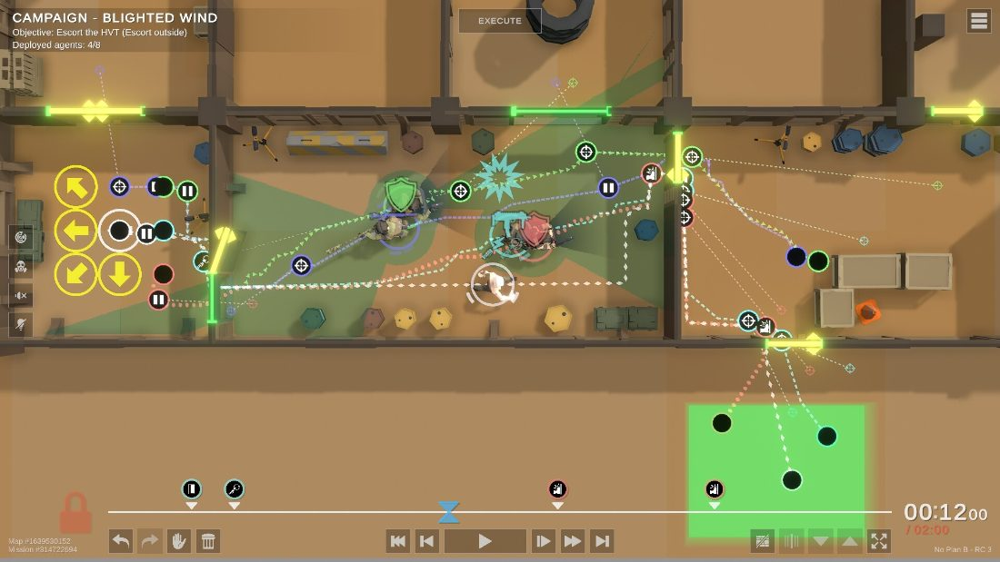
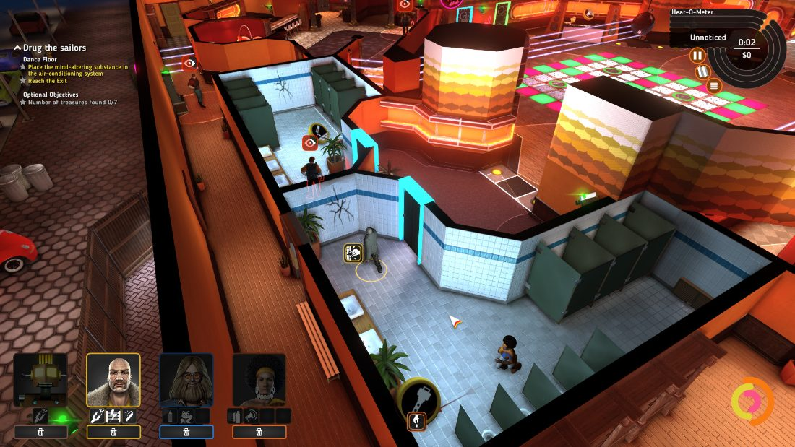
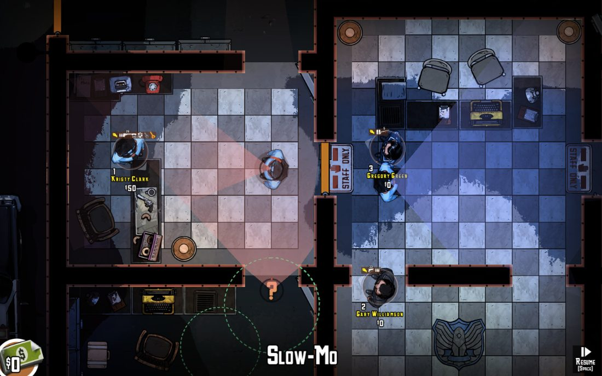
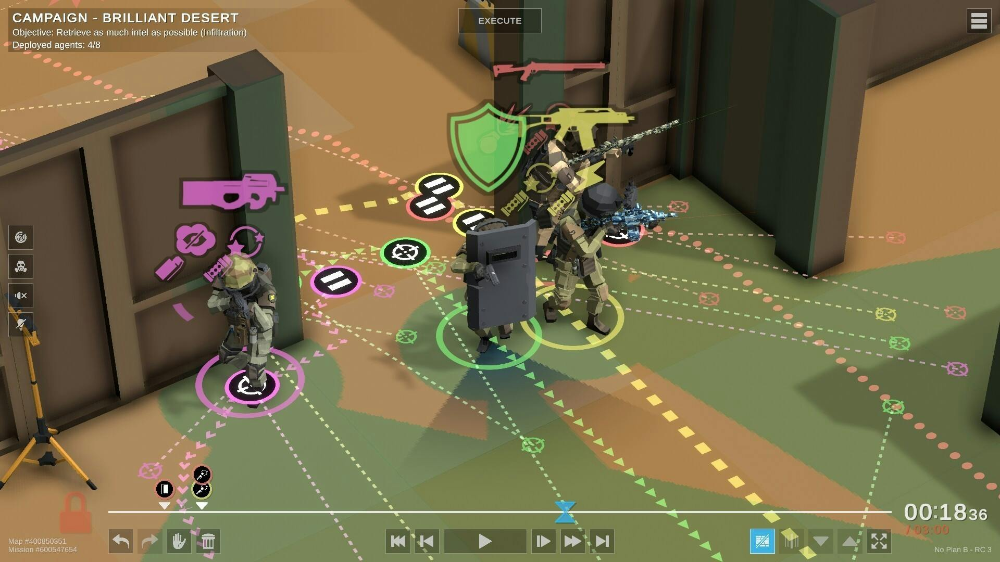

# השוד המושלם | PERFECT HEIST

**משפט שיווקי:** השוד מתחיל בתוכנית טובה — לא במרוץ נגד השעון.

## מהות המשחק

"השוד המושלם" הוא משחק חשיבה ואסטרטגיה דו־ממדי שבו השחקנים מתכננים שוד בדיוני מראש וצופים בביצוע התוכנית לאחר הפעלתה. אפשר לשחק לבד או בשני שחקנים הנמצאים פיזית יחד מול מחשב אחד, בשיתוף פעולה מקומי ללא משחק רשת. בתחילת המשימה בוחרים שתי דמויות מתוך חמש בעלות יכולות שונות; ברמה הקלה, בשלבים מתקדמים, אפשר לצרף **דמות מסייעת שלישית**. ברמה הבינונית הצוות כולל **לפחות 3 דמויות**, וברמה הקשה **4 דמויות** (ראו [תכנון הרמות](Level_Design.md)). כל הדמויות מקבלות פקודות מראש. **לבחירת הדמויות ולתכנון אין הגבלת זמן**: המשתתפים בוחנים את המפה, מתקנים את התוכנית ומפעילים אותה רק כששניהם מוכנים; לאחר כישלון אפשר לשנות פקודות או לבחור דמויות מחדש.

**פלטפורמה:** מחשב אישי, עכבר ומקלדת; במצב זוגי משתמשים באותו מסך ובאותו ממשק תכנון. אין צורך בשני מחשבים או בחיבור לרשת.

**תצוגה:** מפה דו־ממדית במבט מלמעלה עם חדרים, שומרים, מצלמות, פריט מטרה, נקודת חילוץ וציר זמן נפרד לכל דמות פעילה (2–4, לפי רמת הקושי).

<!-- להשלמה: ציור־מסך מקורי של מסך התכנון: חמש דמויות לבחירה, מפה וצירי זמן; בשלבים מתקדמים הצגת ציר שלישי. -->

---

## רכיבים רשמיים

### 1. שחקנים

**קהל היעד:** בני נוער מגיל 12 ומעלה ומבוגרים שאוהבים אסטרטגיה, פתרון חידות ותכנון שיתופי. ההתחלה נגישה, והשלבים המאוחרים מחייבים תיאום מורכב יותר.

**מספר שחקנים:** שחקן אנושי אחד או שני שחקנים אנושיים. מספר הדמויות הפעילות שונה ממספר השחקנים: ברמה הקלה פועלות שתי דמויות, ובשלבים מתקדמים אפשר להוסיף שלישית. ברמה הבינונית פועלות לפחות שלוש, וברמה הקשה ארבע.

- **מצב יחיד:** שחקן אחד בוחר שתי דמויות שונות מתוך חמש ומתכנן את פעולות שתיהן; בשלב מתקדם ברמה הקלה הוא יכול לבחור גם דמות שלישית. ברמה הבינונית והקשה הוא מתכנן פקודות לשלוש או לארבע דמויות.
- **מצב זוגי מקומי:** שני שחקנים יושבים יחד מול מחשב ומסך משותפים. כל משתתף בוחר דמות אחת ואחראי לתכנון הפקודות שלה. כשיש דמות שלישית, השניים בוחרים אותה יחד ומחליטים מי מהם יהיה אחראי לפקודותיה. ברמה הקשה, עם ארבע דמויות, כל משתתף אחראי לשתיים. אפשר להחליף את האחראי לפני ההרצה. העכבר והמקלדת משותפים ומשמשים לתכנון לפי תור.
- **בחירת דמויות:** בוחרים דמויות שונות מתוך חמש; אין חובה לבחור תפקיד מסוים. אין הגבלת זמן לבחירה או לתכנון.

**דפוס אינטראקציה:** שיתוף פעולה מלא, לא תחרות. המשתתפים חולקים יעד, הצלחה וכישלון, ומתכננים יחד בקצב שלהם. בזמן ההרצה כל הדמויות פועלות אוטומטית על פי ההוראות שנקבעו, ללא שליטה בזמן אמת.

### 2. יעדים

**המטרה הכללית:** להשלים סדרת משימות שוד בדיוניות בחנות תכשיטים, במוזיאון ובבנק באמצעות בחירת צוות, תכנון פעולות, השגת פריט המטרה והגעה לנקודת החילוץ.

**תנאי ניצחון בכל שלב:**

1. אחת הדמויות הפעילות משיגה את פריט המטרה.
2. **כל הדמויות הפעילות** (2–4, לפי רמת הקושי) מגיעות לנקודת החילוץ בשלום.
3. הדמויות לא מתגלות באופן שמכשיל את המשימה; בשלבים שמוגדר להם חלון זמן לביצוע, התוכנית צריכה להסתיים בתוך אותו חלון **מרגע תחילת ההרצה בלבד**.

**הצגת היעדים:** לפני התכנון מופיע כרטיס משימה, לדוגמה: "מוזיאון — השיגו את היהלום והגיעו כולם ליציאה המזרחית". רשימת מטרות תוצג בצד המפה ותסומן לאחר השלמה. אם לשלב יש מגבלת זמן לביצוע, היא תוצג לצד ההרצה ותהיה ידועה מראש בעת התכנון; **לא קיים שעון שסופר לאחור בזמן בחירת דמויות או תכנון**.

### 3. תהליכים

#### א. 30 השניות הראשונות — תיאור חוויית הכניסה, לא מגבלת זמן

הדרישה לתאר את 30 השניות הראשונות עוסקת ברושם הראשוני מהמשחק. **אין ציפייה שהשחקנים יסיימו לבחור דמויות, לתכנן או לבצע שוד בתוך 30 שניות**.

- **בעת הפתיחה:** מופיע מסך ברור עם שתי אפשרויות: "שחקן יחיד" ו־"שני שחקנים באותו מחשב". ברקע יש הצצה למפה עם דמויות ומסלולים מתוכננים.
- **עם הכניסה למסך הבחירה:** מופיעות חמש הדמויות, היכולות שלהן והסבר קצר כיצד משלבים ביניהן. המשתתפים רשאים לקרוא, לשוחח, להשוות ולשנות בחירה **ללא הגבלת זמן**.
- **לאחר בחירת הדמויות, כאשר המשתתפים מחליטים להתקדם:** מוצגת מפת הדרכה קטנה עם מיקום המטרה, מסלול שומר ונקודת יציאה. מופיעה הדגמה לא מחייבת של הוספת פקודת תנועה לציר הזמן.
- **המשך בקצב אישי:** השחקנים מתכננים כל עוד הם רוצים, ובוחרים מתי ללחוץ על "הפעל". אפשר לצפות בדוגמה קצרה של ההרצה לפני תכנון עצמאי, אך היא אינה מכריחה אותם להתחיל או לסיים פעולה תוך זמן מסוים.

המטרה בחצי הדקה הראשונה היא ליצור סקרנות והבנה של המכניקה: **בחירת צוות → תכנון → הרצה → למידה ושיפור**.

#### ב. תהליך הליבה — רצף הפעולות החוזר

1. **בחירת מצב וצוות:** בתחילת משימה נבחרות שתי דמויות שונות מתוך חמש. ברמה הקלה, במשימות מתקדמות, נפתחת אפשרות להוסיף דמות מסייעת שלישית מתוך הדמויות שלא נבחרו. ברמה הבינונית בוחרים לפחות שלוש דמויות, וברמה הקשה ארבע.
2. **חלוקת האחריות:** במצב זוגי כל משתתף אחראי לפקודות הדמות שלו. אם הצטרפה דמות שלישית, המשתתפים קובעים מראש מי מהם יתכנן לה פקודות; במצב יחיד אותו שחקן מנהל את כל הדמויות.
3. **הכרת המפה:** בוחנים מטרות, דרכי כניסה, שומרים, מצלמות, דלתות ואזורי סיכון. כל המידע שמותר לשחקנים לדעת בשלב זה גלוי להם ללא לחץ זמן.
4. **בניית התוכנית:** מסמנים לדמויות נקודות תנועה ומציבים פעולות על צירי הזמן שלהן, למשל "לך לחדר", "המתן", "השתמש ביכולת" ו־"אסוף את הפריט".
5. **תיאום ותיקונים:** מזיזים פעולות על ציר הזמן ומתאמים בין הדמויות, כולל הדמות המסייעת אם קיימת. אפשר לשנות, למחוק ולהוסיף פקודות ללא הגבלת זמן או מספר שינויים.
6. **אישור:** בשחקן יחיד יש אישור אחד. במצב זוגי כל שחקן לוחץ "מוכן" לאחר שסיים לתכנן את הדמות או הדמויות שבאחריותו. רק אחרי שני האישורים ניתן להתחיל.
7. **הרצה אוטומטית:** מרגע הלחיצה על "הפעל" הדמויות מבצעות את התוכנית ללא שינוי פקודות בזמן אמת. **משך ההרצה אינו בהכרח 30 שניות**; הוא תלוי באורך ובמורכבות המשימה. בשלב עם מגבלת זמן, היא חלה על ההרצה בלבד.
8. **משוב וניסיון חוזר:** אם התוכנית נכשלת, מוצגת הסיבה לכישלון. אפשר לבחור בין "תקן תוכנית" תוך שמירת ההוראות, לבין "בחר דמויות מחדש" שמחזיר למסך בחירת הצוות ומתחיל תכנון חדש לאותה משימה.

**חמש הדמויות לבחירה והיכולות שלהן:**

| דמות | יכולת ראשונה | יכולת שנייה | תרומה לצוות |
|---|---|---|---|
| **האקר** | השבתת מצלמה למשך 8 שניות במהלך ההרצה | חשיפת סדרי הסיור הידועים של השומרים בתכנון | תיאום מסלול בטוח באזור מצולם |
| **פורץ** | פתיחה מהירה של מנעולים וכספות בדיוניות | נשיאת פריט משימה כבד ללא האטה | קיצור שלב איסוף השלל |
| **מתגנב** | תנועה שקטה שמקטינה את טווח זיהוי הרעש | מעבר בנתיבי שירות צרים | שימוש בנתיבים חלופיים |
| **מתחזה** | הסחת דעת של שומר למשך 6 שניות | מעבר רגיל באזורי אורחים | יצירת חלון הזדמנות לדמויות האחרות |
| **טכנאי** | השבתת מחסום לייזר למשך 8 שניות | פתיחת דלת שירות חלופית | יצירת נתיב גישה בטוח |

המספרים הם ערכי תכנון שניתן לאזן במהלך הפיתוח. יכולות ייחודיות מעניקות יתרון, אך כל שלב יתוכנן כך שיהיו פתרונות גם בלי דמות מסוימת. ברמה הקלה, דמות שלישית **מסייעת** ולא חובה כדי לנצח. ברמה הבינונית והקשה גודל הצוות (3 או 4) הוא חלק מהאתגר, אבל גם שם אין חובה לבחור דמות **מסוימת**.

**דוגמה מפורטת — שלב בסיסי:**

במוזיאון יש יהלום בחדר תצוגה, מצלמה ושומר. שני שחקנים בוחרים בהאקר ובמתגנב.

1. השחקן הראשון מתכנן להשבית מצלמה החל משנייה 5 של *ההרצה*, למשך 8 שניות.
2. השחקן השני מתכנן לעבור במסדרון בשנייה 6, לאסוף את היהלום ואז להגיע ליציאה.
3. לשניהם יש זמן בלתי מוגבל לבדוק ולשנות את רצף הפעולות לפני הפעלה.
4. לאחר ששניהם לוחצים "מוכן", מתחילה ההרצה. אם המתגנב מאחר ומתגלה, אפשר לחזור לתכנון או לבחור צמד חדש — למשל פורץ וטכנאי — ולתכנן פתרון אחר.

**דוגמה מפורטת — שלב מתקדם עם מסייע:**

במוזיאון גדול יש שני אזורי אבטחה ופריט מטרה בחדר הפנימי. שחקן 1 בוחר **האקר**, שחקן 2 בוחר **פורץ**, והם מוסיפים **מתחזה** כדמות שלישית. השניים מחליטים ששחקן 2 יהיה אחראי גם לפקודות המתחזה.

1. שחקן 1 קובע להאקר פקודה להשבתת המצלמה בשנייה 10 של ההרצה.
2. שחקן 2 מגדיר למתחזה פקודת הסחת דעת בשנייה 8, ולפורץ פקודת התקדמות לחדר המטרה בשנייה 11.
3. הם מתקנים יחד את ציר הזמן, ללא מגבלת זמן, עד שהתוכנית מתואמת.
4. במהלך ההרצה שלוש הדמויות מבצעות את ההוראות. אם השוד נכשל, אפשר לשפר את התיאום, להחליף את הדמות המסייעת או לבחור מחדש את כל הצוות.

**השליטה במשחק:**

| פעולה | פקד / ממשק | תוצאה |
|---|---|---|
| בחירת דמות / אזור | לחיצה בעכבר | נפתחת אפשרות לתכנן פעולה |
| תנועה | בחירת יעד במפה | מתווספת פקודת תנועה לציר הזמן |
| הוספת יכולת | בחירת יכולת ברשימה | מתווספת פעולה מתוזמנת |
| תיאום זמנים | גרירת פקודות | שינוי סדר הפעולות וזמנן |
| מעבר בין דמויות | בחירה בכרטיס הדמות | מעבר לציר הזמן שלה (גם השלישי אם נוסף) |
| שיוך מסייע לאחד השחקנים | בחירה במסך הצוות | אותו שחקן אחראי לפקודותיו |
| אישור תכנון | "מוכן" | אישור של כל שחקן; אין דדליין |
| ביצוע | "הפעל" | תחילת ההרצה האוטומטית |
| כישלון | "תקן תוכנית" או "בחר דמויות מחדש" | שיפור פקודות קיימות או בניית צוות חדש |

**לימוד התהליכים:** הדרכה קצרה מסבירה כיצד בוחרים ומנהלים דמויות, בונים ציר זמן ומריצים. בשלבים מתקדמים תוצג הדרכה נוספת לפתיחת המסייע ולשיוך הפקודות שלו לאחד המשתתפים.

#### ג. תהליך הסיום

השוד מסתיים בניצחון כאשר פריט המטרה נאסף וכל הדמויות הפעילות מגיעות לנקודת החילוץ ללא תפיסה, ואם לשלב יש מגבלת זמן לביצוע — גם בתוך חלון הזמן של ההרצה. מופיע מסך הצלחה ובו משך הביצוע, מספר הניסיונות ואפשרות להתקדם או לשחק מחדש עם צוות אחר.

בכישלון מוצגת סיבת הכישלון, למשל "הפורץ התגלה בשנייה 18 של ההרצה". המשתתפים יכולים לבחור:

- **תקן תוכנית:** נשארים עם הדמויות שנבחרו, שומרים את הפקודות ומשנים אותן.
- **בחר דמויות מחדש:** חוזרים למסך הצוות, מחליפים את אחת הדמויות או את כולן, כולל המסייע אם זמין בשלב, ומתחילים תכנון חדש. אין הגבלה על מספר הניסיונות או על זמן התכנון.

### 4. חוקים

- כל הדמויות בצוות שונות זו מזו, מתוך חמש. גודל הצוות נקבע לפי רמת הקושי: ברמה הקלה **שתיים**, ובשלבים מתקדמים **אפשרות**, לא חובה, לדמות מסייעת שלישית. ברמה הבינונית **לפחות שלוש**, וברמה הקשה **ארבע**.
- מספר השחקנים האנושיים נשאר **אחד או שניים**, גם כשפועלות שלוש או ארבע דמויות. במצב זוגי כל דמות נוספת מקבלת פקודות מאחד משני המשתתפים, לפי החלטתם לפני ההרצה.
- **אין שום מגבלת זמן לבחירת דמויות, לחלוקת אחריות או לתכנון.** אפשר לשנות את הבחירות והפקודות עד הלחיצה על "הפעל".
- במצב זוגי שני המשתתפים חייבים לאשר שהם מוכנים לפני תחילת ההרצה.
- בזמן ההרצה אין אפשרות לשנות פקודות; הפעולות מתבצעות לפי סדרן ובכפוף למשך הפעולות ולהתנהגות מערכות המשחק.
- כל דמות מבצעת פעולה רק כשהיא במקום המתאים ואינה עסוקה בפעולה אחרת.
- לכל דמות שתי יכולות ייחודיות. חלקן מוגבלות במספר שימושים או במשך ההשפעה, ואחרות הן יתרון קבוע.
- פעולות בסיסיות כמו תנועה, איסוף פריט ופתיחת דלת רגילה זמינות לכל דמות. אין שלב שמחייב בחירת דמות ייחודית אחת כדי לאפשר ניצחון.
- שומרים ומצלמות מזהים דמויות לפי שדות ראייה ומסלולי סיור קבועים. גילוי שמוגדר כמכשיל את המשימה מוביל לכישלון.
- ברמה הקשה יש מגבלת זמן **לביצוע השוד בלבד**, והיא מתחילה להימדד רק לאחר הפעלת התוכנית.
- לאחר כישלון אפשר לשפר את אותה תוכנית, או לשנות את הרכב הדמויות ולבנות תוכנית אחרת. אין הגבלת ניסיונות.

**תוצאות פעולות:** נקבעות לפי מיקום הדמויות, תזמון הפקודות *בזמן ההרצה*, משכי היכולות, דפוסי האבטחה וכללי השלב. למשל, מצלמה מושבתת בין שנייה 5 ל־13 של ההרצה; דמות שחוצה את האזור בשנייה 12 לא תתגלה בגללה, אך דמות שחוצה בשנייה 14 עלולה להתגלות.

**לימוד החוקים:** הסברים במסך הבחירה, סימוני פעולות חוקיות, הדרכה בלתי מוגבלת בזמן והודעות משוב מדויקות לאחר ניסוי.

### 5. משאבים

**א. בחירת דמויות:** מתוך חמש אפשרויות בוחרים בתחילת משימה שתי דמויות עם יתרונות משלימים. ברמה הקלה, בשלבים מתקדמים, נפתחת האפשרות להוסיף דמות מסייעת שלישית. ברמה הבינונית בוחרים לפחות שלוש, וברמה הקשה ארבע. זהו משאב אסטרטגי מפני שאי אפשר להשתמש בכל חמש היכולות יחד, ונדרשת בחירה של הרכב צוות.

**ב. יכולות מיוחדות:** יכולות פעילות, כגון השבתת מצלמה או הסחת דעת, מוגבלות למשל לשני שימושים לדמות בכל ניסיון; יכולות קבועות פועלות ללא מכסה. מספר השימושים מוצג לצד הדמות, ומתרענן עם התחלת ניסיון חדש.

**ג. חלונות תזמון במהלך ההרצה:** לשומרים מסלולי סיור, ולחלק מהיכולות יש משך מוגבל. המשתתפים יכולים לנתח את החלונות הללו ללא לחץ זמן בשלב התכנון, אך בזמן הביצוע הפעולות צריכות להתאים לאילוצי השלב.

**ד. זמן ביצוע, כשקיים:** בחלק מהשלבים המטרה כוללת השלמת המשימה בתוך משך ביצוע מסוים; ספירת הזמן מתחילה רק לאחר "הפעל". **זמן הבחירה והתכנון אינו משאב מוגבל ולא נספר.**

**השגת משאבים והגבלת נדירות:** היכולות מתקבלות עם בחירת הדמות, ותפקיד נוסף נפתח רק בשלבים מתקדמים. לא כל דמות זמינה בו־זמנית בצוות, ושימושים מיוחדים מוגבלים לכל ניסיון. צג הדמויות, מד השימושים וציר הזמן מראים לשחקנים את המשאבים הזמינים.

### 6. עימותים

**שחקנים מול המערכת:** שמירה על סדר הפקודות, מסלולי השומרים, מצלמות, דלתות, מכשולים ולעיתים גם חלון ביצוע מוגבל. ברמה הבינונית והקשה נדרש תיאום של שלוש או ארבע דמויות פעילות במקום שתיים.

**בין משתתפים:** אין תחרות ביניהם. במצב הזוגי יכולים להתעורר חילוקי דעות לגבי הרכב הצוות, מסלולים או התזמון, ובמקרה של מסייע נוסף גם לגבי מי יתכנן אותו; פותרים זאת בדיון משותף לפני ההרצה, **בלי לחץ של זמן**.

**דילמות אישיות:** האם לבחור פורץ מהיר או האקר שמפחית סיכון? האם לשמור יכולת לסוף או לנצל אותה מיד? האם לשלב מסייע כדי לקצר דרך מסוכנת או להסתפק בשתי דמויות ולהשיג דירוג גבוה יותר על פתרון חסכוני?

**דוגמה:** אחרי ניסיון שנכשל, המשתתפים צריכים להחליט אם לשפר את תזמון האקר+מתגנב, או לבחור צוות חדש של פורץ+טכנאי. בשלבים מתקדמים אפשר לצרף מתחזה כמסייע ולתת לאחד המשתתפים לתזמן עבורו הסחת דעת.

### 7. גבולות

**סוג העולם:** עולם דו־ממדי, סגור ושטוח, עם מפות נפרדות לבניינים בדיוניים. אין מעבר מקצה מפה לקצה הנגדי ואין עולם פתוח.

**הצגת הגבולות:** קירות, דלתות נעולות, מסלולים חסומים וסימוני "אין מעבר". ניסיון לתת פקודה למקום חסום יציג מסלול באדום.

**עקרונות תכנון המפה:**

- **משמעות:** לכל חדר תפקיד ברור — חדר אבטחה, מחסן, חדר המטרה, מסדרון שירות או יציאה.
- **ניידות:** לכל שלב יהיו כמה מסלולים אפשריים, כך שלא יהיה חייב לבחור דמות מסוימת; עם פתיחת המסייע אפשר לתכנן מסלול מקביל נוסף.
- **התמצאות:** סימונים וצבעים שונים למצלמות, לשומרים ולדמויות; לכל דמות פעילה ציר זמן בצבע משלה, כולל הדמות השלישית בשלבים המתאימים.
- **עניין:** מפות ומכשולים שונים, חמש דמויות, אפשרות להחלפת צוות לאחר כישלון והוספת מסייע בשלבים קשים מעודדים ניסיונות חוזרים.
- **הכוונה:** פריט המטרה והיציאה מסומנים בבירור, ועוזרי ממשק מצביעים על פקודות מתנגשות בלי לחשוף פתרון מלא. אין לחץ להספיק את ההדרכה בתוך פרק זמן מוגדר.

### 8. תוצאות

**תוצאות מרכזיות:**

1. **ניצחון משותף:** פריט המטרה הושג, וכל הדמויות הפעילות (2–4) חולצו בהתאם לתנאי המשימה.
2. **הפסד משותף:** דמות נתפסה, הופעלה התרעה שמכשילה את השוד, לא הושגה מטרת המשימה או חלף חלון הביצוע בשלב שמגדיר חלון כזה.

**אחרי הפסד:** אפשר לחזור לאותה תוכנית ולתקן אותה **או לבחור מחדש את הדמויות** ולבנות תוכנית אחרת. אם הדמות השלישית פתוחה בשלב, אפשר גם לצרף אותה או להחליף אותה. אין מספר ניסיונות מוגבל.

**דירוג:** לאחר הצלחה ניתן לדרג את איכות הביצוע לפי שימוש ביכולות, משך ההרצה או מספר ניסיונות, אך **לא לפי משך הזמן שלקח למשתתפים לתכנן**.

**מזל מול כישרון:** הדגש על תכנון, חשיבה ותיאום. מסלולי הסיור ותנאי ההתחלה קבועים בכל ניסיון באותו שלב, כך שהשחקנים יכולים ללמוד מכישלון ולשפר באופן שיטתי.

**אופי המשחק:** שיתופי מקומי במצב שני שחקנים, או שחקן יחיד מול מערכת; אין עימות סכום אפס בין משתתפים.

---

## סקירת משחקים קיימים

### ביטויי החיפוש

ההשוואה מבוססת על עמודי המשחקים הרשמיים ועל חיפוש משחקי אסטרטגיה העוסקים בתכנון משימות מראש ובניהול צוות דמויות. ביטויי החיפוש הרלוונטיים:

- `heist strategy game plan execute team`
- `No Plan B timeline tactical game`
- `Crookz The Big Heist crew planning`
- `The Masterplan top down heist game`
- `local co-op planning heist game`

### 1. No Plan B

**קישור:** https://store.steampowered.com/app/1269020/No_Plan_B/

**תיאור:** משחק טקטי שבו בונים מראש תוכנית לפעולות צוות על גבי ציר זמן, ומריצים אותה כדי לצפות בדמויות מבצעות את ההוראות. המשחק כולל משימות מסוגים שונים, וביניהן גם שוד בנק.

**הדמיון:** מערכת תכנון על ציר זמן, תיאום פעולות של מספר דמויות והרצה אוטומטית של התוכנית.

**הבידול שאנחנו מתכננים:** מתמקדים במשימות שוד קצרות בדו־ממד, עם **חמש דמויות לבחירה, שתי דמויות פעילות בתחילה ואפשרות למסייע שלישי בשלבים מתקדמים**, ואפשרות מובנית לכך ששני חברים יישבו ליד **אותו מחשב ויתכננו יחד**; כל אחד אחראי לדמות שלו, ושניהם חייבים לאשר את התוכנית לפני הביצוע. בחירת צמד שונה או הוספת מסייע בשלבים קשים משנה את דרך התכנון; אחרי כישלון ניתן לבחור צוות מחדש.

**צילום מסך:**

*צילום מסך מתוך No Plan B (מקור: עמוד המשחק ב־Steam): המסלולים והפעולות של כל סוכן מסומנים על המפה, וציר הזמן בתחתית מסנכרן ביניהם לפני לחיצה על EXECUTE. אצלנו שני חברים יתכננו יחד על אותו מסך, כל אחד את הדמות שלו, ויצטרכו לאשר את התוכנית במשותף.*

### 2. Crookz – The Big Heist

**קישור:** https://store.steampowered.com/app/310490/Crookz__The_Big_Heist/

**תיאור:** משחק אסטרטגיה טקטי בעולם שוד בדיוני, הכולל דמויות עם יכולות שונות, מכשולי אבטחה ותכנון פעולות; אפשר לעצור את הפעילות כדי לתכנן.

**הדמיון:** ניהול דמויות בעלות יכולות משלימות, תכנון מסלולים והתגנבות מול מערכות אבטחה.

**הבידול שאנחנו מתכננים:** במקום ניהול משימה בזמן אמת עם עצירות, אצלנו מתקיימת **הפרדה מלאה** בין תכנון וביצוע. במשחק הזוגי שני המשתתפים בונים תוכנית אחת על מסך משותף; בזמן ההרצה לא ניתן לתקן הוראות, ולכן התיאום המוקדם הוא האתגר המרכזי.

**צילום מסך:**

*צילום מסך מתוך Crookz – The Big Heist (מקור: עמוד המשחק ב־Steam): צוות של דמויות מומחיות, כל אחת עם יכולות משלה, ומד "Heat-O-Meter" שמראה אם הצוות התגלה. ב־Crookz אפשר לעצור ולתת פקודות חדשות באמצע; אצלנו התכנון והביצוע נפרדים לגמרי.*

### 3. The Masterplan

**קישור:** https://store.steampowered.com/app/313080/The_Masterplan/

**תיאור:** משחק שוד טקטי דו־ממדי במבט מלמעלה, שבו מנהלים צוות ומתכננים פעולות תוך אפשרות להאט את הזמן במהלך השוד.

**הדמיון:** זווית תצוגה דו־ממדית, ניהול כמה דמויות, משימות שוד ופתרון בעיות טקטיות.

**הבידול שאנחנו מתכננים:** שיתוף פעולה מקומי של שני שחקנים על אותו מסך, בחירת שתי דמויות מתוך חמש והוספת מסייע שלישי בשלבים מתקדמים. השחקנים לא שולטים בדמויות בזמן אמת: כל ההוראות מוכנות מראש, ואפשר לערוך ניסיון חוזר תוך שמירה על התוכנית הקודמת.

**צילום מסך:**

*צילום מסך מתוך The Masterplan (מקור: עמוד המשחק ב־Steam): מבט מלמעלה על חדרי הבניין, השומרים ושדות הראייה שלהם, עם מצב Slow-Mo לתגובה בזמן אמת. אצלנו אין שליטה בזמן הביצוע — כל ההוראות מוכנות מראש, ואפשר לנסות שוב תוך שמירה על התוכנית הקודמת.*

### מדוע שחקנים עשויים להעדיף את המשחק שלנו?

*תמונת המחשה לסגנון שאנחנו מכוונים אליו (צילום מסך מתוך No Plan B): כל דמות מקבלת צבע משלה, המסלולים והפעולות מסומנים על המפה, וציר הזמן בתחתית מסנכרן ביניהן לפני ההפעלה. ב"השוד המושלם" המפה תהיה דו־ממדית ופשוטה יותר, ושני שחקנים יתכננו יחד ליד אותו מחשב.*

המשחק מיועד לחברים שרוצים **לפתור חידות יחד ליד אותו מחשב** במקום לשחק דרך רשת. חמישה תפקידים שונים מאפשרים להתנסות בשילובים שונים ולמצוא כמה פתרונות לאותו שלב. כישלון אינו מחייב התחלה מאפס: אפשר לשפר את התוכנית הקודמת או לבחור מחדש דמויות ולתכנן גישה אחרת. בשחקן יחיד נשמר אותו מנגנון, אך אותו שחקן מנהל שתי דמויות, וברמות הקשות יותר עד ארבע.

אין כאן טענה שהתכנון מראש, בחירת תפקידים או משחקי שוד הם רעיונות חדשים בפני עצמם; הייחוד המבוקש הוא **השילוב** בין שיתוף פעולה מקומי, בחירת צוות מתוך חמש דמויות שגדל לפי רמת הקושי (2 עד 4), תכנון ללא מגבלת זמן וחידות עם ניסיונות חוזרים והחלפת צוות.

### אילו רכיבים רשמיים ידגישו את הייחוד?

- **שחקנים:** אפשרות לבחור בין שחקן יחיד לבין שני שחקנים היושבים פיזית יחד, עם מטרה משותפת ולא תחרותית.
- **תהליכים:** בחירת צוות מתוך חמש דמויות (2 ברמה הקלה, 3–4 ברמות הקשות יותר), חלוקת פקודות בין שני השחקנים, תכנון ללא מגבלת זמן והרצה אוטומטית.
- **חוקים:** אין שינוי פקודות בזמן הביצוע; אין מגבלת זמן לתכנון; אין שלב שמחייב דמות מסוימת. ברמה הקלה לכל זוג דמויות יש דרך להשלים שלב, וברמות הקשות יותר גודל הצוות הנדרש עולה.
- **משאבים:** צוות של 2–4 דמויות מתוך חמש, לפי רמת הקושי, שימושים מוגבלים ביכולות וחלונות זמן במהלך ההרצה בלבד.
- **תוצאות:** אחרי כישלון אפשר לתקן את אותה תוכנית או לבחור צוות חדש, ולנסות שוב ללא הגבלת ניסיונות.

<!-- להשלמה לפני ההגשה: ציור־מסך מקורי של המשחק להמחשת מהות המשחק והרכיבים הרשמיים, ושלושה צילומי משחק אמיתיים לסקר השוק. -->

