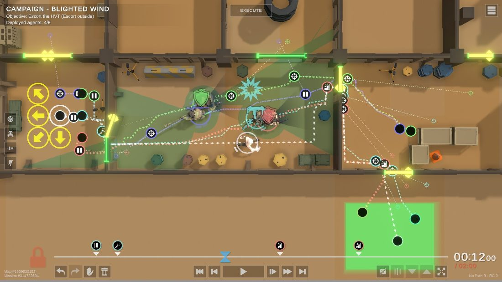
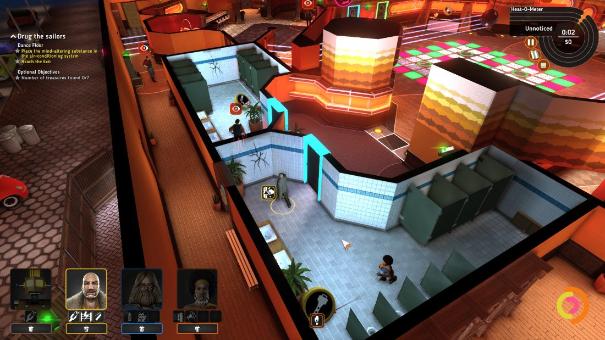
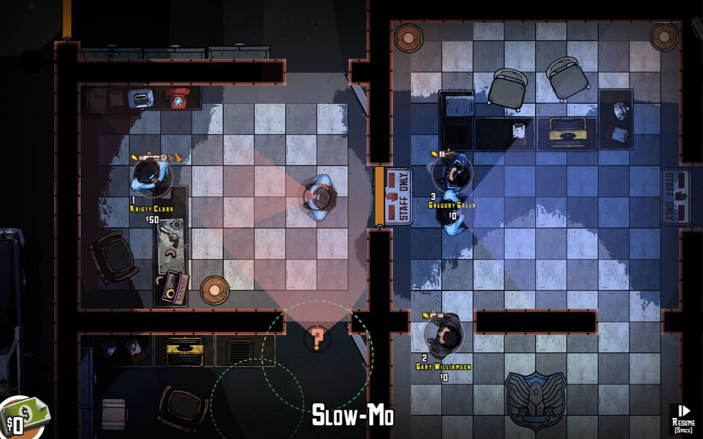
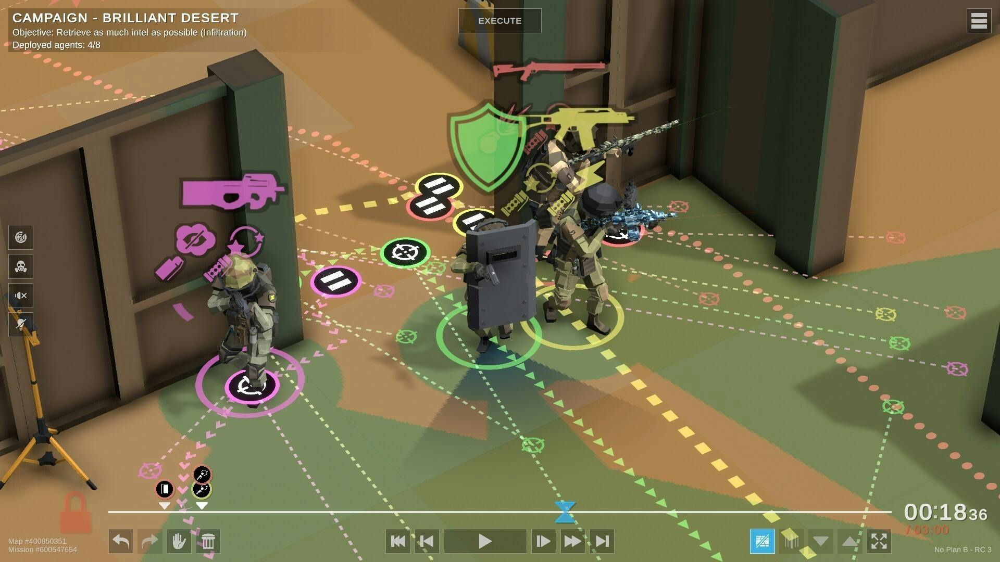

# השוד המושלם – PERFECT HEIST

**משפט שיווקי:** השוד מתחיל בלחיצה אחת, אבל ההצלחה נקבעת בתכנון שלפניה.

## מהות המשחק

"השוד המושלם" הוא משחק אסטרטגיה וחשיבה דו־ממדי שבו השחקן מנהל צוות של שלושה שודדים בדיוניים ומתכנן עבורם משימות במקומות כמו בנק, מוזיאון וחנות תכשיטים. במקום לשלוט בדמויות בזמן הביצוע, השחקן מתכנן מראש לאן כל דמות תלך, איזו פעולה תבצע ומתי, ואז צופה בתוכנית מתבצעת אוטומטית. לכל דמות יכולת ייחודית, ולכן הצלחה מחייבת תיאום מדויק בין חברי הצוות וניצול חלונות זמן קצרים. כשמשהו משתבש, השחקן לומד מההרצה, מתקן את התוכנית ומנסה שוב.

**פלטפורמה:** מחשב אישי (Windows), באמצעות עכבר ומקלדת.

**תצוגה מתוכננת:** מפה דו־ממדית במבט מלמעלה, עם דמויות, חדרים, מכשולים, שומרים ולוח זמנים לתכנון פעולות.

<!-- להשלמה בסוף: ציור־מסך מקורי של המשחק, כפי שהצוות מדמיין אותו, בהתאם לתבנית המרצה. -->

---

## רכיבים רשמיים

### 1. שחקנים

המשחק מיועד **לשחקן יחיד**, בעיקר לבני נוער מגיל 12 ומעלה ולמבוגרים שאוהבים משחקי חשיבה, אסטרטגיה ותכנון. הוא מתאים גם לשחקנים חסרי ניסיון, משום שהשלב הראשון מלמד כיצד להזיז דמויות בלוח התכנון ולתזמן פעולות; שלבים מתקדמים מיועדים לשחקנים שמחפשים אתגר מורכב יותר.

אין מצב משחק שיתופי או תחרותי בין בני אדם: השחקן מתכנן את התוכנית עבור כל הצוות ומנסה לגבור על אתגרי המערכת. דמויות השודדים הן יחידות בשליטת אותו שחקן, ולא שחקנים נפרדים.

### 2. יעדים

**המטרה הכללית:** להשלים בהצלחה סדרת משימות שוד בדיוניות, שכל אחת מהן דורשת השגת פריט משימה וחילוץ הצוות לפני תום הזמן, בלי שיתגלה על ידי מערכות האבטחה במשחק.

בכל שלב נדרשים שלושה תנאים כדי לנצח:

1. להוביל את הדמות המתאימה אל פריט המטרה ולאסוף אותו.
2. לשמור שהצוות לא ייתפס על ידי שומרים או מצלמות פעילות.
3. להביא את כל הדמויות ואת הפריט אל נקודת היציאה לפני סיום הזמן המוקצב.

**הצגת היעדים:** בתחילת כל שלב מופיע מסך משימה קצר, למשל: "השג את היהלום, והוצא את כל הצוות דרך שער היציאה בתוך 35 שניות". במהלך התכנון ובזמן ההרצה מוצגים בחלק העליון של המסך יעד השלל, סמל לכל איש צוות, שעון המשימה וסימון ברור של נקודת היציאה. השלמת יעד משנה את הסמל שלו לסימון הצלחה; במקרה של כישלון מוצגת הסיבה המדויקת.

### 3. תהליכים

#### א. תהליך ההתחלה – 30 השניות הראשונות

**שניות 0–8:** השחקן רואה מפה קטנה של חנות תכשיטים במבט מלמעלה: שודד ליד הכניסה, חלון ראווה ובו פריט המטרה, מסלול סיור של שומר ויציאה מסומנת. מוצג המסר: "אתה המתכנן. סמן לשודד לאן ללכת, ואז הפעל את התוכנית".

**שניות 8–18:** בעזרת העכבר השחקן לוחץ על הדמות, בוחר משבצת יעד ולוחץ על הפקודה "עבור לכאן". בלוח הפעולות מופיעה ההוראה בתחילת ציר הזמן. השחקן מוסיף פעולת "אסוף פריט" לאחר ההגעה לחלון הראווה, ולבסוף הוראת תנועה לעבר היציאה.

**שניות 18–25:** השחקן לוחץ על כפתור "הפעל" ורואה את השודד מבצע את ההוראות. אם הוא עובר במסלול הסיור של השומר, התוכנית נעצרת ומופיע הסבר ברור: "השומר זיהה את השודד בשנייה 7".

**שניות 25–30:** לחיצה על "חזור לתכנון" מאפשרת לשנות את נקודת המעבר או את מועד התנועה ולהריץ מחדש. השחקן מגלה מיד את הרעיון המרכזי: **מתכננים, מריצים, מזהים בעיה ומשפרים**.

#### ב. תהליך הליבה – מה השחקן עושה שוב ושוב?

1. **לומד את המפה:** רואה חדרים, דלתות, עמדות מצלמה, מסלולי סיור ומיקום הפריט. מידע זה גלוי בתכנון, ולכן האתגר הוא תיאום ולא ניחוש.
2. **בוחר דמות:** לחיצה עם העכבר על אחד משלושת אנשי הצוות מדגישה את היכולות הייחודיות שלו.
3. **מתכנן פעולות:** השחקן לוחץ על מיקום במפה ובוחר "תנועה", "אינטראקציה" או יכולת מיוחדת. הפעולות מופיעות בציר זמן אישי לכל דמות, וניתן לגרור אותן קדימה או אחורה בעזרת העכבר.
4. **מתאם בין דמויות:** חלק מהפקודות מתבצעות בשנייה קבועה וחלק יכולות להמתין לאות בתוך המשחק, למשל "התחל להתקדם כשהמצלמה מושבתת". הדבר מאפשר תכנון המבוסס על **תלות בין פעולות** ולא רק על שעון.
5. **מריץ את התוכנית:** לחיצה על "הפעל" מתחילה הדמיה שבה כל הדמויות פועלות אוטומטית. אי אפשר לשנות הוראות במהלך ההרצה; ניתן רק להשהות את הצפייה או לחזור לתכנון.
6. **בודק את התוצאה:** במקרה של כישלון מוצג תחקיר קצר: באיזו שנייה, איזו דמות ואיזו פעולה גרמו לבעיה. השחקן משנה הוראות ומריץ שוב.
7. **משלים את המשימה:** אם נאסף הפריט וכל חברי הצוות מגיעים ליציאה בלי להתגלות ובזמן, עוברים לשלב הבא.

**תפקידי הדמויות המתוכננים:**

| דמות | יכולת | שימוש במשחק |
|---|---|---|
| ההאקר | השבתת מצלמה במשחק לזמן מוגבל | יצירת חלון זמן למעבר באזור מצולם |
| הפורץ | פתיחת דלתות וכספות המסומנות כנעולות | השגת פריט המטרה |
| המתגנב | תנועה מהירה ויצירת הסחת דעת מוגבלת | הסטת שומר ממסלול הצוות |

**דוגמה מפורטת למשימה:** במפת מוזיאון יש מסדרון עם מצלמה, חדר תצוגה עם יהלום ויציאה צדדית. בשנייה 5 ההאקר מפעיל יכולת שמשביתה מצלמה למשך 12 שניות. המתגנב יוצר הסחת דעת בשנייה 6, וכך שומר מסייר מתרחק ממעבר מרכזי. הפורץ מקבל הוראה להתחיל לחצות את המסדרון *לאחר קבלת אות שהמצלמה כבויה*, מגיע לחדר התצוגה, פותח את מתקן התצוגה במשך 4 שניות ואוסף את היהלום. לאחר מכן שלוש הדמויות נעות אל נקודת היציאה לפי תוכנית מתוזמנת. אם הפורץ מתעכב ומופיע במצלמה אחרי שחלון ההשבתה הסתיים, ההרצה נכשלת והשחקן יכול להזיז פעולה מוקדם יותר או לבחור מסלול אחר.

המספרים בדוגמה הם **ערכי תכנון** לצורך המחשה, ויותאמו בבדיקות משחק.

**מקשי השליטה:**

| פקד | פעולה |
|---|---|
| לחיצה שמאלית בעכבר | בחירת דמות, מיקום או פעולה בתפריט |
| גרירה בעכבר | שינוי מועד פעולה בציר הזמן |
| גלגלת העכבר | הגדלה והקטנה של המפה או ציר הזמן |
| רווח | הפעלה / השהיה של צפייה בהרצה |
| R | התחלה מחדש של ההרצה על בסיס התוכנית הקיימת |
| Esc | פתיחת תפריט או חזרה למסך התכנון |

#### ג. תהליך הסיום

ברגע שפריט המשימה נאסף וכל אנשי הצוות מגיעים לאזור היציאה, המשחק בודק שהתוכנית לא הפרה את תנאי השלב ושנותר זמן. אם התנאים מתקיימים, מופיע מסך הצלחה עם זמן הביצוע, מספר ניסיונות ודירוג של עד שלושה כוכבים. השחקן יכול לצפות בשידור חוזר, לשפר את הדירוג או לעבור למשימה הבאה.

אם איש צוות נתפס, אם שומר מפעיל התראה או אם הזמן מסתיים לפני ההגעה ליציאה, מופיע מסך כישלון. אפשר לחזור מייד ללוח התכנון תוך שמירה על כל ההוראות הקודמות, ולתקן רק את החלק שיצר את הכישלון.

**כיצד ילמד השחקן את התהליכים?** השלב הראשון מציג פקודות בסיסיות בהדרכה קצרה. בשלב השני נפתחת דמות נוספת והסבר על תיאום פעולות, ובהמשך מתווספים אותות, מצלמות ומגבלות זמן. ניתן להציג הסבר קצר באמצעות מעבר העכבר על סמלי הפעולות.

### 4. חוקים

- **הפרדה בין תכנון לביצוע:** רק בשלב התכנון אפשר לתת פקודות. בזמן ביצוע הדמויות מצייתות לפקודות הקיימות בלבד.
- **פעולה חוקית:** דמות יכולה לפעול רק במקום שאליו הגיעה, ורק אם יש לה את היכולת המתאימה. לדוגמה, רק הפורץ פותח כספת ורק ההאקר מפעיל את פקודת השבתת המצלמה.
- **משך פעולות:** תנועה, פתיחת דלתות והפעלת יכולות דורשות זמן מוגדר; פעולה לא יכולה להתחיל אם הדמות עסוקה בפעולה קודמת. ציר הזמן יציג התנגשות בין הוראות שאי אפשר לקיים במקביל.
- **הוראות מותנות:** הוראה כמו "התקדם אחרי שהמצלמה כובתה" ממתינה לאירוע הנדרש. אם האירוע אינו מתרחש עד סוף הזמן, הפקודה לא תתבצע והמשימה עשויה להיכשל.
- **שמירה על חשאיות:** אם שומר מזהה דמות באזור הראייה שלו או מצלמה פעילה קולטת אותה באזור אסור, המשימה נכשלת. מכשולים וקירות מסתירים דמויות באופן שהמפה מציגה לשחקן.
- **סופיות משימה:** יש לאסוף את הפריט ולהביא את כל אנשי הצוות ליציאה לפני תום השעון.
- **ניסיונות חוזרים:** אפשר לתכנן מחדש ללא הגבלת ניסיונות. כל הרצה מתחילה מאותן עמדות ומאותם מסלולי סיור, כדי לאפשר שיפור על בסיס למידה.

**איך נקבעות תוצאות הפעולות?** המשחק משתמש בחוקים קבועים: משך פעולה, תפקיד הדמות, מיקום היחידות וטווחי גילוי מוגדרים. אין שינוי אקראי בהתנהגות השומרים בתוך אותו שלב, כך שהשחקן מבין למה תוכנית מסוימת הצליחה או נכשלה.

**איך לומדים את החוקים?** הדרכות קצרות, סימוני טווח ראייה ומעברי עכבר על סמלי פעולות מסבירים מראש מה ניתן ומה לא ניתן לעשות. בעת כישלון המערכת מציינת את החוק שהופר ואת הזמן שבו זה קרה.

### 5. משאבים

**א. זמן משימה:** לכל שלב שעון מוגבל, למשל 35 שניות בסיבוב לימוד. הזמן משמש לתזמון והגבלת האפשרויות; אי אפשר להוסיף לו זמן בזמן ההרצה. שעון גדול בלוח התכנון ובמסך הביצוע מראה כמה זמן נשאר.

**ב. חלונות זמן ליכולות מיוחדות:** השבתת מצלמה והסחת דעת זמינות לפרקי זמן מוגדרים. הן מאפשרות מעבר בטוח אך מחייבות תיאום. הממשק מציג כמה זמן תימשך כל יכולת באמצעות פס צבעוני על ציר הזמן.

**ג. אמצעי הסחת דעת:** בכל שלב יוקצו מספר מוגבל של שימושים ביכולת ההסחה, לדוגמה שימוש אחד או שניים בלבד. השחקן מקבל אותם בתחילת המשימה; הם אינם מתחדשים בתוך אותה הרצה. סמל ליד דמות המתגנב מראה כמה שימושים נשארו.

**ד. אנשי צוות בעלי יכולות שונות:** שלוש הדמויות עצמן הן משאב אסטרטגי. אחת לא יכולה לבצע את תפקידה של האחרת, ולכן הן צריכות להגיע למקומות שונים בזמן המתאים. פס מצב ליד כל דמות מציג את הפעולה הנוכחית ואת מיקומה.

**מדוע המשאבים נדירים?** שעון המשימה אינו ארוך, חלונות האבטחה קצרים, ומספר ההסחות מוגבל. השחקן צריך לתכנן בדיוק מתי להשתמש במשאבים ולא יכול לעקוף כל מכשול בעזרת אותו פתרון.

### 6. עימותים

**בין השחקן למערכת:** מסלולי שומרים, מצלמות, דלתות נעולות, זמני פעולה וחלון זמן מוגבל. כל מכשול דורש בחירה של דמות ותזמון מתאימים.

**בין השחקן לשחקנים אחרים:** אין עימות מול שחקנים אנושיים. השומרים הם חלק ממערכת המשחק ופועלים לפי מסלולי סיור וכללי זיהוי קבועים.

**בין השחקן לעצמו – דילמות:** האם לבחור בדרך קצרה שעוברת ליד מצלמה או במסלול בטוח שלוקח יותר זמן? האם להשתמש בהסחת הדעת כבר עכשיו או לשמור אותה למעבר קשה יותר? האם לתזמן פעולה לשנייה מדויקת או להתנות אותה באירוע של דמות אחרת, כך שתהיה פחות מהירה אך אמינה יותר?

**דוגמה:** הפורץ יכול להגיע לכספת בשנייה 12 במסדרון הקצר, אבל הסיור של השומר עובר שם בשנייה 11. מסלול עוקף מביא אותו בשנייה 17 ומקטין את הסיכון, אך מותיר פחות זמן לחילוץ. השחקן צריך להחליט איזו תוכנית עדיפה.

### 7. גבולות

**סוג העולם:** העולם סגור ושטוח, עם מפות דו־ממדיות נפרדות לכל משימה. כל מפה מתארת בניין בדיוני מסוים, למשל חנות, בנק או מוזיאון. אין מעבר בין קצות המפה, והיא אינה עגולה.

**הצגת גבולות:** קירות המבנה, דלתות חסומות וקו תוחם ברור מסמנים לאן אפשר להגיע. אזורי פעולה, מסלולי תנועה ונקודת היציאה מוצגים בסמלים שונים. ניסיון לתת הוראה אל מחוץ למפה מסומן כהוראה לא חוקית.

**חמשת עקרונות התכנון:**

- **משמעות:** כל חדר תורם למשימה — חדר אבטחה מאפשר להשבית מצלמה, חדר תצוגה מכיל את פריט המטרה, ומסדרון צדדי מאפשר מסלול חלופי.
- **ניידות:** יש יותר מנתיב אחד אל היעד לפחות בחלק מהשלבים. תנועה תלויה באורך המסלול, בדלתות נעולות ובפעולות אחרות שבוצעו לפני כן.
- **התמצאות:** חדרים בעלי צבעים וסמלים מובחנים, חיצי תנועה ושמות אזורים עוזרים להבין היכן כל דמות נמצאת ומה המסלול שלה.
- **עניין:** שילובים משתנים של מצלמות, שומרים, חדרים ודלתות יוצרים בעיות תכנון שונות, ולא רק הגדלה של מספר המכשולים.
- **הכוונה:** סימון בולט של פריט המטרה ושל אזור היציאה, יחד עם ציר זמן והדגשת הוראות שגויות, מבהירים מה נדרש בלי לפתור את החידה עבור השחקן.

### 8. תוצאות

יש **שתי תוצאות סופיות לכל משימה**:

1. **הצלחה:** הפריט נאסף, כל הצוות הגיע ליציאה והמשימה הושלמה במסגרת הזמן ומבלי להתגלות.
2. **כישלון:** איש צוות התגלה או נתפס, הזמן הסתיים, או שהתוכנית לא הצליחה להשלים את היעדים.

במקרה של הצלחה נוסף דירוג של כוכב אחד עד שלושה, המבוסס על זמן הביצוע ועל מספר ניסיונות או שימושים בהסחות דעת. הדירוג משמש לעידוד שיפור ולא משנה את עצם הניצחון.

**מזל לעומת כישרון:** התוצאה תלויה בעיקר בכישרון: הבנת מסלולים, תזמון, תכנון פעולות ותיקון טעויות. כל ניסיון באותו שלב מתחיל מתנאים קבועים, כדי למנוע כישלון שנובע ממזל בלבד.

**סוג המשחק:** משחק לשחקן יחיד מול מערכת עם תוצאה לא־שיתופית. אין כאן משחק סכום אפס תחרותי בין שני שחקנים אנושיים, כי רק שחקן אחד מנהל את הצוות ומטרתו לנצח את אתגרי השלב.

---

## סקירת משחקים קיימים

### ביטויי החיפוש והדרך שבה חיפשנו

נערכה בדיקת משחקים דומים בעמודי המשחקים בחנות Steam ובחיפוש ברשת. ביטויי החיפוש:

- `heist strategy game planning crew`
- `plan and execute heist game timeline`
- `No Plan B tactical planning game`
- `Crookz The Big Heist strategy`
- `The Masterplan top down heist game`

נבחרו שלושה משחקים דומים, לפי ההתאמה למכניקת התכנון, ניהול צוות וביצוע משימות שוד.

### 1. No Plan B

**קישור למשחק:** https://store.steampowered.com/app/1269020/No_Plan_B/

**תיאור:** משחק טקטי שבו השחקן מתכנן מראש סדרת פעולות של צוות על ציר זמן, מפעיל את התוכנית וצופה בחברי הצוות פועלים באופן אוטומטי. המשחק כולל גם אפשרות למשימות שוד בנק לצד סוגי משימות נוספים.

**הדמיון למשחק שלנו:** מבין המשחקים שנבדקו, זהו הדמיון המרכזי ביותר: תכנון מפורט מראש, סנכרון פעולות וצפייה בביצוע ללא שינוי הוראות תוך כדי הפעולה. לכן לא נכון לטעון שהמכניקה הזאת כשלעצמה חדשה.

**כיצד המשחק שלנו יהיה שונה:** הדגש יהיה על חידות שוד קצרות בדו־ממד, עם **שלוש דמויות קבועות בעלות תפקידים משלימים**, ומערכת של **הוראות מותנות באירועים** כגון "התחל רק לאחר שאיש צוות אחר סיים פעולה". לאחר כישלון יוצג תחקיר ממוקד המציין את הפעולה והשנייה שגרמו לו, כדי לעודד ניסויים קצרים ושיפור של התוכנית.

**צילום מסך:**

*צילום מסך מתוך No Plan B (מקור: עמוד המשחק ב־Steam): מסלולי התנועה והפעולות של כל סוכן מסומנים על המפה, וציר הזמן בתחתית מסנכרן ביניהם לפני לחיצה על EXECUTE. אצלנו יתווספו הוראות מותנות באירועים ותחקיר שמראה איזו פעולה ובאיזו שנייה גרמה לכישלון.*

### 2. Crookz – The Big Heist

**קישור למשחק:** https://store.steampowered.com/app/310490/Crookz__The_Big_Heist/

**תיאור:** משחק אסטרטגיה טקטי בסגנון שנות השבעים, שבו מרכיבים צוות בעל יכולות שונות ומתכננים משימות שוד תוך התמודדות עם מערכות אבטחה. אפשר לעצור את הפעולה כדי לתכנן מהלכים.

**הדמיון למשחק שלנו:** בשני המשחקים יש צוות דמויות מומחיות, תכנון מסלולים, תזמון ותיאום מול מכשולים ומערכות אבטחה.

**כיצד המשחק שלנו יהיה שונה:** במשחק שלנו אין מתן פקודות חדשות במהלך ההרצה; כל ההחלטות מתקבלות מראש. הדגש אינו על קמפיין שוד רחב, אלא על חידות קצרות ומוגדרות שבהן השחקן מנסה למצוא רצף הוראות מוצלח, לבדוק אותו ולשפר אותו במהירות.

**צילום מסך:**

*צילום מסך מתוך Crookz – The Big Heist (מקור: עמוד המשחק ב־Steam): צוות של דמויות מומחיות, כל אחת עם יכולות משלה, ומד "Heat-O-Meter" שמראה אם הצוות התגלה. ב־Crookz אפשר לעצור ולתת פקודות חדשות באמצע; אצלנו כל ההוראות נקבעות מראש.*

### 3. The Masterplan

**קישור למשחק:** https://store.steampowered.com/app/313080/The_Masterplan/

**תיאור:** משחק שוד טקטי דו־ממדי במבט מלמעלה, שבו השחקן מנהל צוות במשימות שוד שונות. ניתן להאט את קצב הפעולה כדי לתכנן ולתת הוראות במהלך המשימה.

**הדמיון למשחק שלנו:** נקודת המבט מלמעלה, ההרכב הקבוצתי, משימות שוד והתכנון האסטרטגי של המסלול ושל פעולות הדמויות.

**כיצד המשחק שלנו יהיה שונה:** השחקן יפעל דרך לוח תכנון וציר זמן בלבד; הביצוע יהיה אוטומטי, והאתגר המרכזי יהיה לא הגבה מהירה במהלך השוד אלא יצירת **תוכנית מתואמת התלויה בתנאים ובחלונות זמן**. הממשק יציג הסבר קצר לכישלון ומאפשר חזרה ישירה לאותה תוכנית.

**צילום מסך:**

*צילום מסך מתוך The Masterplan (מקור: עמוד המשחק ב־Steam): מבט מלמעלה על חדרי הבניין, השומרים ושדות הראייה שלהם, עם מצב Slow-Mo לתגובה בזמן אמת. אצלנו אין התערבות בזמן הביצוע — האתגר הוא לתכנן מראש תוכנית שמתואמת לחלונות הזמן.*

### מה יגרום לשחקנים לבחור במשחק שלנו?

*תמונת המחשה לסגנון שאנחנו מכוונים אליו (צילום מסך מתוך No Plan B): כל דמות מקבלת צבע משלה, המסלולים והפעולות מסומנים על המפה, וציר הזמן בתחתית מאפשר לסנכרן ביניהן לפני ההפעלה. ב"השוד המושלם" המפה תהיה דו־ממדית ופשוטה יותר, עם שלושה שודדים בלבד והוראות כמו "התחל רק אחרי שהפורץ פתח את הדלת".*

המשחק מתוכנן כחוויה ממוקדת של "בנה תוכנית → לחץ הפעל → גלה מה השתבש → תקן". שלבים קצרים וממשק ידידותי מיועדים להפוך את הלמידה מהטעויות למרכיב מהנה, במקום לדרוש ניהול מורכב בזמן אמת. תפקידים משלימים והוראות מותנות אמורים להוסיף חידות תיאום שמרגישות כמו פתרון פאזל חי.

חשוב להדגיש: הרעיון **דומה למשחקים קיימים**, במיוחד ל־No Plan B. הייחוד שתואר כאן הוא יעד עיצובי שאנחנו רוצים לממש ולבחון, ולא טענה שהשילוב לא קיים בשום משחק אחר.

### אילו רכיבים רשמיים מדגישים ביותר את הייחוד?

- **תהליכים:** התכנון מראש של כמה דמויות במקביל, עם פקודות שמופעלות לפי אירועים ותחקיר קצר בסוף כל ניסיון.
- **חוקים:** איסור על מתן פקודות חדשות בזמן הביצוע, ומערכת ברורה של תלות בין פעולות.
- **עימותים:** דילמות בין מהירות התוכנית, מספר ההסחות וסיכוני הגילוי.
- **תוצאות:** ניסיון חוזר בתנאים קבועים, כך שהשחקן יכול לראות אם שינוי קטן באמת שיפר את התוכנית.

